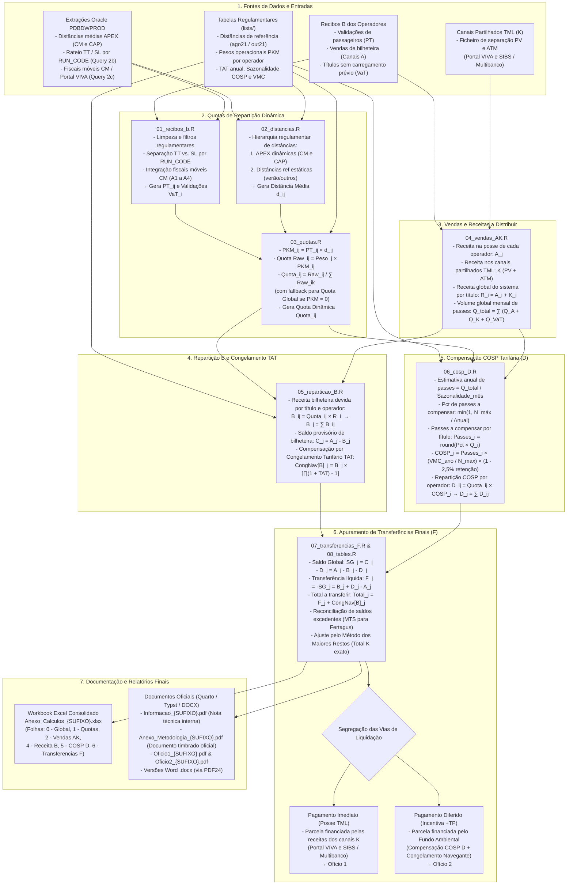

# Distribuição de Receitas Navegante — Procedimento e Documentação

> **Implementação em R**: `code/99_run_all.R`
> Alterar `ANO` e `MES` em `code/config.R` e correr `Rscript code/99_run_all.R`.
> Os outputs ficam em `{MES_ANO}_replicate/` com sufixo `{SUFIXO}` (ex: `mai26`, `jun26`).

---

## Fluxograma Metodológico

O fluxograma seguinte sintetiza o encadeamento metodológico e operacional do apuramento de compensações e distribuição de receitas Navegante (ao abrigo do [Regulamento n.º 1362-C/2023](https://diariodarepublica.pt/dr/detalhe/regulamento/1362-c-2023-835674356)), mapeando as fontes de dados de entrada, os scripts de processamento em R, as fórmulas regulamentares de cálculo e os produtos finais gerados:



### Síntese das Fases Metodológicas


| Fase                                 | Script(s)                            | Designação Regulamentar                                                                                                                                                                                                   | Entradas Principais                                                                                | Saídas Principais                                                                                |
| -------------------------------------- | -------------------------------------- | ----------------------------------------------------------------------------------------------------------------------------------------------------------------------------------------------------------------------------- | ---------------------------------------------------------------------------------------------------- | --------------------------------------------------------------------------------------------------- |
| **1. Validações e Passageiros**    | `01_recibos_b.R`                     | Passageiros Transportados ($PT$) e Reconciliação                                                                                                                                                                          | Recibos B (`PTconsideredByProduct`), Oracle (`query_SL_TT.sql`, `query_CM_fiscaismoveis.sql`)      | `1a_PT_{SUFIXO}.csv`, `1b_PT_CM_{SUFIXO}.csv`, `1d_validacoes_{SUFIXO}.csv` (VaT)                 |
| **2. Distâncias Médias**           | `02_distancias.R`                    | Distâncias Médias Percorridas ($\bar{d}_{i,j}$)                                                                                                                                                                           | Oracle APEX (`AVERAGE_DISTANCE`), tabelas de referência sazonal (`distanciasref_*.csv`)           | `1e_distancias_{SUFIXO}.csv`                                                                      |
| **3. Quotas de Repartição**        | `03_quotas.R`                        | Quota de Repartição Dinâmica ($\text{Quota}_{i,j}$) | Passageiros Transportados ($PT$), Distâncias Médias ($\bar{d}$), Pesos PKM (`pesos_pkm.csv`)                                                                     | `1_quotas_{SUFIXO}.csv` (PKM, Quotas por título)                                                  |                                                                                                   |
| **4. Vendas A e K**                  | `04_vendas_AK.R`                     | Apuramento de Vendas e Volume Global                                                                                                                                                                                        | Recibos B (`transactionsOperatorSystem`), Separação PV/ATM (`ReciboB_*_Separação_PV_ATM.xlsx`) | `2_vendas_A_{SUFIXO}.csv`, `2_vendas_K_{SUFIXO}.csv`, `4a_receita_titulo_distribuir_{SUFIXO}.csv` |
| **5. Repartição B e Congelamento** | `05_reparticao_B.R`                  | Receita Devida ($B$) e Congelamento Navegante | Quotas dinâmicas, Receita a distribuir ($R_i$), Taxa de Atualização Tarifária (`tat.csv`)                                                                               | `4b_reparticao_B_{SUFIXO}.csv`, `4_receitaB_congelamento_{SUFIXO}.csv`                             |                                                                                                   |
| **6. Compensação COSP**            | `06_cosp_D.R`                        | Pagamento por Conta da COSP Tarifária ($D$) | Volume total de passes ($Q$), Sazonalidade mensal (`sazonalidade.csv`), VMC regulado                                                                                         | `5a_cosp_{SUFIXO}.csv`, `5_cosp_operador_{SUFIXO}.csv`                                             |                                                                                                   |
| **7. Transferências Finais**        | `07_transferencias_F.R``08_tables.R` | Apuramento de Transferências ($F$) e Relatório Excel                                                                                                  | Receitas $A$, $B$, $D$, Congelamento TAT, canais partilhados $K$ | `6_transferencias_{SUFIXO}.csv`, `Anexo_Calculos_{SUFIXO}.xlsx` (6 folhas)                         |                                                                                                   |
| **8. Documentos Oficiais**           | `10_documentos.R`                    | Informação Técnica e Ofícios de Liquidação                                                                                                                                                                            | Tabelas consolidadas, parâmetros de emissão (`doc_params.R`), templates Typst                    | `Informacao_{SUFIXO}.pdf`, `Anexo_Metodologia_{SUFIXO}.pdf`, `Oficio1/2_{SUFIXO}.pdf`             |

---

## Estrutura de scripts

```
code/
├── config.R                  # Parâmetros globais, constantes e caminhos
├── 00_setup.R                # Instala/carrega pacotes R
├── 01_recibos_b.R            # Agrega Recibos B (PT + receitas)
├── 02_distancias.R           # Resolve distâncias médias por título × operador
├── 03_quotas.R               # Calcula PKM e quotas de distribuição
├── 04_vendas_AK.R            # Agrega receitas A (operadores) + K (PV/ATM)
├── 05_reparticao_B.R         # Distribui receita B + Congelamento TAT
├── 06_cosp_D.R               # Calcula COSP (D)
├── 07_transferencias_F.R     # Calcula transferências finais F
├── 08_tables.R               # Exporta workbook Excel consolidado (Anexo_Calculos)
├── 10_documentos.R           # Renderiza todos os documentos Quarto (PDF + DOCX opcionalmente)
├── 99_run_all.R              # Script mestre — corre os 9 passos em sequência
│
├── informacao1.qmd           # Informação 1 — nota interna de apresentação dos resultados
├── metodologia.qmd           # Anexo Metodologia — documento externo com papel timbrado
├── oficio1.qmd               # Ofício 1 — comunicação formal de pagamentos imediatos
├── oficio1_alt.qmd           # Ofício 1 (variante) — tabelas no fim dos itens numerados
├── oficio2.qmd               # Ofício 2 — comunicação formal relativa ao Incentiva +TP
│
├── render_informacao1.R      # Script rápido para renderizar só a Informação 1
├── doc_params.R              # ← Parâmetros de emissão mensais: datas, refs, autores (editar a cada mês)
├── utils_tables.R            # Funções de formatação de tabelas com tinytable (Typst)
├── utils_extenso.R           # Funções auxiliares para montantes por extenso em euros
│
├── custom_styles.typ         # Estilos Typst: cabeçalhos, fundos e papel timbrado
├── linebreaks.lua            # Filtro Pandoc: quebras de linha e deteção de doc-tipo externo
├── query_SL_TT.sql           # Query Oracle para separação TT/SL (Query 2b)
├── query_CM_fiscaismoveis.sql# Query Oracle para fiscais móveis CM (Query 2c)
└── templates/                # Modelos e recursos visuais oficiais (versionados no Git)
    ├── folha_1.pdf           # Fundo timbrado oficial da 1.ª página (vetorial)
    ├── folha_restantes.pdf   # Fundo timbrado oficial das páginas seguintes (vetorial)
    ├── logo_tml.svg          # Logótipo vetorial institucional TML
    └── TML_template.docx     # Modelo de referência Word
```

## Variáveis principais em `config.R`


| Variável            | Exemplo                              | Descrição                                                                                 |
| ---------------------- | -------------------------------------- | --------------------------------------------------------------------------------------------- |
| `ANO`                | `2026`                               | Ano de distribuição                                                                       |
| `MES`                | `5`                                  | Mês de distribuição (inteiro)                                                            |
| `SUFIXO`             | `"mai26"`                            | Sufixo para nomes de ficheiros:`paste0(mes_abrev, ano_curto)`                               |
| `DATA_DIR`           | `05_mai_2026/`                       | Pasta com dados do mês (Recibos B, etc.)                                                   |
| `REPLICATE_DIR`      | `05_mai_2026_replicate/`             | Pasta de replicação do mês                                                               |
| `INPUT_DIR`          | `05_mai_2026_replicate/input/`       | Pasta de inputs específicos do mês (ex: APEX distâncias)                                 |
| `OUT_DIR`            | `05_mai_2026_replicate/output/`      | Pasta de outputs gerados pelos scripts                                                      |
| `DOCS_DIR`           | `05_mai_2026_replicate/output/docs/` | Pasta de destino para relatórios e ofícios gerados                                        |
| `RENDER_INFORMACAO1` | `TRUE`                               | Booleano: controla a renderização da Informação 1                                       |
| `RENDER_OFICIO1`     | `FALSE`                              | Booleano: controla a renderização do Ofício 1                                            |
| `RENDER_OFICIO2`     | `FALSE`                              | Booleano: controla a renderização do Ofício 2                                            |
| `RENDER_DOCX`        | `FALSE`                              | Booleano:`TRUE` converte o PDF para Word (DOCX) via PDF24 Toolbox                           |
| `DOCX_MODE`          | `"asposeFlow"`                       | Modo de conversão PDF24:`"asposeFlow"` (texto corrido) ou `"asposeBlocks"` (blocos/caixas) |
| `LISTS_DIR`          | `lists/`                             | Tabelas estáticas de referência                                                           |
| `DIST_REF_FILE`      | `distanciasref_out21_incompleto.csv` | Distâncias de referência (verão →`ago21`)                                               |
| `APEX_ENTITY_IDS`    | `c(75, 22)`                          | Entidades com distâncias dinâmicas (CM, CAP)                                              |
| `CM_SUBOPS`          | `c("A1","A2","A3","A4")`             | Sub-operadores da Carris Metropolitana                                                      |
| `VMC_2023`           | `112562432.41`                       | Valor Máximo Compensação COSP regulado                                                   |
| `N_PASSES_COMPENSAR` | `8472279`                            | Nº máximo passes anuais a compensar (regulamentar)                                        |
| `RETENCAO_TML`       | `0.025`                              | Retenção TML sobre COSP (2.5%)                                                            |
| `TAT_FILE`           | `lists/tat.csv`                      | Taxa de Atualização Tarifária por ano                                                    |

## Ficheiros de output (em `OUT_DIR`)

Todos os ficheiros de output usam o sufixo `{SUFIXO}` no nome (ex: `mai26`).
As variáveis `F_*` em `config.R` centralizam todos os caminhos.


| Variável R              | Ficheiro                                    | Produzido em            | Conteúdo                                                                                                                                                            |
| -------------------------- | --------------------------------------------- | ------------------------- | ---------------------------------------------------------------------------------------------------------------------------------------------------------------------- |
| `F_PT`                   | `1a_PT_{SUFIXO}.csv`                        | `01_recibos_b.R`        | Passageiros transportados por título × operador                                                                                                                    |
| `F_PT_CM`                | `1b_PT_CM_{SUFIXO}.csv`                     | `01_recibos_b.R`        | CM = soma de A1+A2+A3+A4                                                                                                                                             |
| `F_RECEITAS`             | `1c_receitas_titulo_{SUFIXO}.csv`           | `01_recibos_b.R`        | Receitas de venda por título × operador (qty e €)                                                                                                                 |
| `F_VAT`                  | `1d_validacoes_{SUFIXO}.csv`                | `01_recibos_b.R`        | Quantidades de títulos gratuitos sem carregamento (VaT)                                                                                                             |
| `F_DISTANCIAS`           | `1e_distancias_{SUFIXO}.csv`                | `02_distancias.R`       | Distância média (km) por título × operador                                                                                                                       |
| `F_QUOTAS`               | `1_quotas_{SUFIXO}.csv`                     | `03_quotas.R`           | PKM e quota (0–1) por título × operador                                                                                                                           |
| `F_VENDAS_A`             | `2_vendas_A_{SUFIXO}.csv`                   | `04_vendas_AK.R`        | Receita na posse de cada operador (A)                                                                                                                                |
| `F_VENDAS_K`             | `2_vendas_K_{SUFIXO}.csv`                   | `04_vendas_AK.R`        | Vendas e receitas dos canais partilhados TML (Portal VIVA e SIBS/ATM)                                                                                                |
| `F_RTD`                  | `4a_receita_titulo_distribuir_{SUFIXO}.csv` | `04_vendas_AK.R`        | Receita total a distribuir por título (A+K) e qty total                                                                                                             |
| `F_REPARTICAO_B`         | `4b_reparticao_B_{SUFIXO}.csv`              | `05_reparticao_B.R`     | Distribuição B por título × operador + congelamento                                                                                                              |
| `F_CONGELAMENTO`         | `4_receitaB_congelamento_{SUFIXO}.csv`      | `05_reparticao_B.R`     | Receita B devida + Congelamento Navegante (TAT) por operador                                                                                                         |
| `F_COSP_D`               | `5a_cosp_{SUFIXO}.csv`                      | `06_cosp_D.R`           | COSP detalhe por título × operador                                                                                                                                 |
| `F_D_OPERADOR`           | `5_cosp_operador_{SUFIXO}.csv`              | `06_cosp_D.R`           | COSP total (D) por operador                                                                                                                                          |
| `F_TRANSFERENCIAS`       | `6_transferencias_{SUFIXO}.csv`             | `07_transferencias_F.R` | **Tabela final CSV**: A, B, D, Congelamento, F, Total por operador                                                                                                   |
| `F_TABELA_XLSX`          | `docs/Anexo_Calculos_{SUFIXO}.xlsx`         | `08_tables.R`           | **Workbook Excel consolidado** (em `docs/`): 6 folhas (0 - Global, 1 - Quotas, 2 - Vendas AK, 4 - Receita B e CongNav B, 5 - Pag Conta COSP D, 6 - Transferencias F) |
| `F_DOC_INFO1_PDF`        | `docs/Informacao_{SUFIXO}.pdf`              | `10_documentos.R`       | **Informação 1** — nota interna com síntese dos resultados mensais                                                                                               |
| `F_DOC_INFO1_DOCX`       | `docs/Informacao_{SUFIXO}.docx`             | `10_documentos.R`       | Versão Word da Informação 1 (se`RENDER_DOCX = TRUE`)                                                                                                              |
| `F_DOC_METODOLOGIA_PDF`  | `docs/Anexo_Metodologia_{SUFIXO}.pdf`       | `10_documentos.R`       | **Anexo Metodologia** — documento externo com papel timbrado e fórmulas regulamentares                                                                             |
| `F_DOC_METODOLOGIA_DOCX` | `docs/Anexo_Metodologia_{SUFIXO}.docx`      | `10_documentos.R`       | Versão Word do Anexo Metodologia (se`RENDER_DOCX = TRUE`)                                                                                                           |
| `F_DOC_OFICIO1_PDF`      | `docs/Oficio1_{SUFIXO}.pdf`                 | `10_documentos.R`       | **Ofício 1** — comunicação formal de pagamentos imediatos a cada operador                                                                                        |
| `F_DOC_OFICIO1_DOCX`     | `docs/Oficio1_{SUFIXO}.docx`                | `10_documentos.R`       | Versão Word do Ofício 1 (se`RENDER_DOCX = TRUE`)                                                                                                                   |
| `F_DOC_OFICIO1ALT_PDF`   | `docs/Oficio1_alt_{SUFIXO}.pdf`             | `10_documentos.R`       | **Ofício 1 (variante)** — tabelas no fim dos itens numerados                                                                                                       |
| `F_DOC_OFICIO2_PDF`      | `docs/Oficio2_{SUFIXO}.pdf`                 | `10_documentos.R`       | **Ofício 2** — comunicação formal relativa às verbas do Incentiva +TP                                                                                           |
| `F_DOC_OFICIO2_DOCX`     | `docs/Oficio2_{SUFIXO}.docx`                | `10_documentos.R`       | Versão Word do Ofício 2 (se`RENDER_DOCX = TRUE`)                                                                                                                   |

---

# Dados iniciais: Recibos B

As receitas por título vendido, em quantidade e pvp, são enviadas por todos os operadores e validadas pela TML quando envia o "Recibo B" (eg: `05_mai_2026/Recibos B`).

Cada operador envia 3 ficheiros, com os nomes maisoumenos assim (tem datas no fim):

- **Passageiros Transportados por título**: `reg_[OPERADOR]_reciboB_PTconsideredByProduct_*.csv`

  - Tem ano (`DISTRIBUTION_YEAR`), mês (`DISTRIBUTION_MONTH`), código operador (`TICKET_OPERATOR_CODE`, 31 é o Navegante, -1 é ..?),
  - `TICKET_CODE`, `OPERADOR_TOTAL`- que é o número total de passageiros transportados por aquele operador, com aquele título
  - Tem também o `SISTEMA_TOTAL`, a soma do numero de passageiros transportados por todos os operadores com aquele título, mas isso é irrelevante para o operador, só por curiosidade.
- **Títulos vendidos**: `reg_[OPERADOR]_reciboB_transactionsOperatorSystem_*.csv`

  - Tem o `SOURCE` (tem "Transaction" e "Validations as Transcactions", estes últimos são títulos que não precisam de ser carregados mas tiveram pelo menos 1 utilização no sistema (não importa o operador).
  - Tem `PERIOD`(acho que é `DISTRIBUTION_YEAR "_" DISTRIBUTION_MONTH`), `TICKET_OPERATOR_CODE`
  - `TICKET_CODE`
  - `OPERADOR_QUANTITY`- que é o total de títulos com aquele código vendidos por esse operador; e `OPERADOR_PRICE`, a receita total de venda desse título que esse operador recebeu (em €)
  - `SIIT_QTY`e  `SIIT_PRICE` são "erros" e devoluções. Portanto deve-se considerar o anterior `+` este, para que bata certo, tanto para a quantidade como para a receita.
  - `SISTEMA_QUANTITY`e `SISTEMA_TOTAL_PRICE`, que são apenas curiosidade do total do sistema de títulos ventidos no total.
- **Lista de validações descartadas**: `reg_[OPERADOR]_reciboB_validationsUnconsidered_*.csv`
  este ficheiro tem a lista de validações incoerentes, de vários tipos, nas máquinas do operador, que não foram consideradas para os ficheiros anteriores. Para este cálculo, este ficheiro é irrelevante.

> Nota: o operador CM (Carris Metropolitana) é equivalente à soma dos operadores A1, A2, A3 e A4.
> Ver `lists/operadores.csv` (`ENTITY_ABBREVIATION` e `OPERATOR_NAME_NAVEGANTE`) para correspondências nos caminhos dos ficheiros.

### Script: `01_recibos_b.R`

Lê todos os Recibos B de todos os operadores e reconcilia dados da Oracle para TT/SL e CM.

**Outputs:**

- `F_PT_CM` → `PT_CM_agregado_{SUFIXO}.csv`: CM = soma de A1+A2+A3+A4 + fiscais móveis (ficheiro intermédio explícito)
- `F_PT` → `PT_{SUFIXO}.csv`: passageiros transportados por título e operador (todos), coluna `pt_operador`
- `F_RECEITAS` → `receitas_titulo_{SUFIXO}.csv`: receitas de venda, colunas `qty_operador` e `receita_operador`

**Filtros aplicados:**

- `SOURCE == "Transaction"` (excluir "Validations as Transactions")
- `ticket_operator_code == 31` (Navegante)
- `ticket_code > 0` (excluir linhas de totais)
- Scotturb (`SC`) excluído

---

### Reconciliação Oracle: TT / SL e Carris Metropolitana

Para bater a 100% com as contas oficiais (folha Excel de validação), é necessário extrair dois ficheiros auxiliares da base de dados Oracle `PDBDWPROD` e colocá-los na pasta `{MES_ANO}_replicate/input/`:

1. **Separação TT / SL**: [`code/query_SL_TT.sql`](file:///c:/GIS/Compensacoes/code/query_SL_TT.sql) (Query 2b)
2. **Fiscais Móveis CM (Portal VIVA)**: [`code/query_CM_fiscaismoveis.sql`](file:///c:/GIS/Compensacoes/code/query_CM_fiscaismoveis.sql) (Query 2c)

```
{MES_ANO}_replicate/input/
├── tt_sl_*(timestamp).csv       ← gerado por query_SL_TT.sql
├── entity23_*(timestamp).csv    ← gerado por query_CM_fiscaismoveis.sql
└── V_REG_AVERAGE_DISTANCE_FINAL_ALL_*(timestamp).csv ← distâncias APEX (CM e Cascais)
```

---

#### 1. Separação TT (Transtejo) / SL (Soflusa) — Query 2b

O Recibo B entregue pela Transtejo (**TT**) contém na coluna `OPERADOR_TOTAL` os passageiros **conjuntos de TT + SL** (os dois operadores fluviais partilham o mesmo Recibo B). O Recibo B separado de SL tem valores diferentes e duplicaria o SL se fosse somado.

> [!IMPORTANT]
> **Armadilha do `ENTITY_ID` na separação TT/SL:**Ao contrário do que seria intuitivo, **não se deve filtrar por `ENTITY_ID = 5` vs `ENTITY_ID = 8`**! Ambas as entidades têm validações registadas de forma cruzada nos cais.A metodologia oficial da TML (reproduzida da fórmula Excel prévio utiliza a **georreferenciação por `RUN_CODE`**:
>
> - **`RUN_CODE = 7` $\rightarrow$ Soflusa (SL)** (ligação fluvial do Barreiro).
> - **Todos os outros `RUN_CODE` (0, 1, 3, 5, 9) $\rightarrow$ Transtejo (TT)** (Cacilhas, Seixal, Montijo, Trafaria).
>
> Além disso, é obrigatório filtrar:
>
> - `VALID_TYPE_ID = 0` (exclui testes / validações de serviço)
> - `VALBYPROF = 0` (exclui perfis profissionais especiais)
> - `TICKET_OPERATOR_CODE = 31` (títulos Navegante)

**Query 2b ([`code/query_SL_TT.sql`](file:///c:/GIS/Compensacoes/code/query_SL_TT.sql)):**

```sql
SELECT
    DISTRIBUTION_YEAR,
    DISTRIBUTION_MONTH,
    TICKET_OPERATOR_CODE,
    TICKET_CODE,
    ENTITY_ID,
    RUN_CODE,
    VALID_TYPE_ID,
    VALBYPROF,
    SUM(QNT_VALIDATION) AS PT_VALIDACOES
FROM DW_PROC.F_VALIDATIONS
WHERE DISTRIBUTION_YEAR  = <ANO>
  AND DISTRIBUTION_MONTH = <MES>
  AND ENTITY_ID IN (5, 8)          -- 5=TT (Transtejo), 8=SL (Soflusa)
  AND TICKET_OPERATOR_CODE = 31    -- Navegante
  AND VALID_TYPE_ID = 0
  AND VALBYPROF = 0
GROUP BY
    DISTRIBUTION_YEAR,
    DISTRIBUTION_MONTH,
    TICKET_OPERATOR_CODE,
    TICKET_CODE,
    ENTITY_ID,
    RUN_CODE,
    VALID_TYPE_ID,
    VALBYPROF
ORDER BY TICKET_CODE, ENTITY_ID, RUN_CODE;
```

- **Gravar em `input/` como:** `tt_sl_*(timestamp).csv` (ex: `tt_sl_202609111613.csv`).
- **Como o script calcula:** O total oficial de TT+SL é ancorado ao Recibo B de TT (`OPERADOR_TOTAL`). Os registos da Oracle fornecem apenas o *rateio percentual* entre TT e SL para cada título, assegurando que `TT + SL = Recibo B de TT` ao passageiro exato.

---

#### 2. Validações Fiscais Móveis CM (Portal VIVA, `ENTITY_ID = 23`) — Query 2c

> [!IMPORTANT]
> **Armadilha das validações em falta na Carris Metropolitana:**
> Os Recibos B das 4 áreas operacionais da CM (A1 a A4) não contêm as validações efetuadas nos terminais móveis dos fiscais. Estas validações ficam registadas no Portal VIVA (`ENTITY_ID = 23`).
> Se não forem somadas, a CM apresenta uma diferença negativa (ficando com validações em falta face ao total oficial do sistema).
>
> **Regras essenciais da reconciliação:**
>
> 1. As validações móveis são distribuídas pelas 4 sub-áreas da CM através do cálculo de `RUN_CODE`:
>    $$\text{Área CM} = \lfloor \text{RUN} / 1000 \rfloor + 40$$
>    - `1xxx` → Código 41 → **Área 1 (A1)**
>    - `2xxx` → Código 42 → **Área 2 (A2)**
>    - `3xxx` → Código 43 → **Área 3 (A3)**
>    - `4xxx` → Código 44 → **Área 4 (A4)**
>
> 2. **Apenas são considerados os títulos que já existem no Recibo B da CM**. Títulos não-Navegante (ex: ticket 33592) são automaticamente ignorados.

**Query 2c ([`code/query_CM_fiscaismoveis.sql`](file:///c:/GIS/Compensacoes/code/query_CM_fiscaismoveis.sql)):**

```sql
SELECT
    DISTRIBUTION_YEAR,
    DISTRIBUTION_MONTH,
    TICKET_OPERATOR_CODE,
    TICKET_CODE,
    23 AS ENTITY_ID,
    FLOOR(RUN_CODE / 1000) + 40 AS AREA_CM,
    VALID_TYPE_ID,
    VALBYPROF,
    SUM(QNT_VALIDATION) AS PT_VALIDACOES
FROM DW_PROC.F_VALIDATIONS
WHERE DISTRIBUTION_YEAR  = <ANO>
  AND DISTRIBUTION_MONTH = <MES>
  AND ENTITY_ID = 23               -- Portal VIVA (validadores móveis CM)
  AND TICKET_OPERATOR_CODE = 31    -- Navegante
  AND VALID_TYPE_ID = 0
  AND VALBYPROF = 0
  AND RUN_CODE BETWEEN 1000 AND 4999
GROUP BY
    DISTRIBUTION_YEAR,
    DISTRIBUTION_MONTH,
    TICKET_OPERATOR_CODE,
    TICKET_CODE,
    FLOOR(RUN_CODE / 1000) + 40,
    VALID_TYPE_ID,
    VALBYPROF
ORDER BY TICKET_CODE, AREA_CM;
```

- **Gravar em `input/` como:** `entity23_*(timestamp).csv` (ex: `entity23_202609111609.csv`).

---

#### 3. Cuidados no Oracle SQL Developer e Versionamento

> [!WARNING]
> **Armadilha do Limite de 200 Linhas no Oracle SQL Developer:**Por omissão, o SQL Developer limita a busca em grelha a 200 registos. Se uma consulta devolver mais de 200 linhas e for exportada sem fazer scroll até ao fim, **o ficheiro CSV fica truncado em 200 linhas**, corrompendo os dados!**Como foi resolvido**:
> As consultas foram pré-agrupadas e otimizadas no SQL:
>
> - `query_SL_TT.sql` devolve apenas ~93 linhas.
> - `query_CM_fiscaismoveis.sql` devolve apenas ~47 linhas.
>   Ambas ficam muito abaixo do limite de 200 linhas e podem ser exportadas diretamente em CSV com total segurança.

> [!TIP]
> **Regra de Seleção Automática de Ficheiros:**
> O script seleciona automaticamente os ficheiros de input em `{MES_ANO}_replicate/input/` segundo a seguinte hierarquia:
>
> 1. **Ficheiro mais recente pela data/timestamp no nome** (formato numérico `YYYYMMDD...`);
> 2. **Se houver mais do que um ficheiro com a mesma data**, usar o que diz `_update` (ou `update`) no nome (ex.: `..._update.csv`);
> 3. Em caso de empate, desempate pelo timestamp completo mais recente (ou `mtime`).
>
> Esta regra aplica-se de forma uniforme e transversal a:
>
> - **Distâncias médias APEX**: qualquer ficheiro com `AVERAGE_DISTANCE` no nome (ex.: `PDBDWPROD_V_REG_AVERAGE_DISTANCE_FINAL_ALL_*.csv` ou `V_REG_AVERAGE_DISTANCE_FINAL_ALL_*.csv`; ficheiros como `distancias_dinamicas` são ignorados);
> - **Tabelas de validações TT / SL**: ficheiros com `tt_sl` no nome (ex.: `tt_sl_*.csv`);
> - **Tabelas de fiscais móveis CM**: ficheiros com `entity23` no nome (ex.: `entity23_*.csv`).

**Comportamento em Fallback (se os ficheiros não existirem em `input/`):**

- TT/SL: assume TT como TT+SL e ignora SL (emitindo um aviso no console).
- CM: não adiciona validações do Portal VIVA (emite aviso de ausência do ficheiro).

---

# 1. Quotas

A partir dos recibos B, juntar as distâncias médias, com peso do operador, para estimar as quotas de cada operador por título.

## Distâncias

Regras para que distâncias utilizar, com a seguinte ordem de preferência:

1. Distância média calculada para a mesma tipologia de título, utilizado no mesmo Operador, em mês semelhante, considerando -se, para este efeito, dois grupos de meses com comportamento semelhante: i) junho, julho e agosto; ii) os restantes meses do ano;
2. Distância média calculada para a mesma tipologia de título, utilizada no mesmo Operador, em meses não semelhantes;
3. Distância média calculada de outro título, com o mesmo título base e modalidade, no mesmo Operador e no mesmo mês;
4. Distância média calculada do título base, no mesmo Operador e no mesmo mês;
5. Distância média definida nas tabelas 4 e 5 constantes da secção VIII. Distâncias Médias de Agosto e Outubro De 2021 (ver `lists/distanciasref_out21_incompleto.csv`).

### Distâncias médias de referência

* Para os meses de verão (Junho, Julho, Agosto), usa-se as distâncias de referência `ago21` → `lists/distanciasref_ago21_incompleto.csv`
* Para os restantes meses do ano (RA), usa-se as distâncias de referência `out21` → `lists/distanciasref_out21_incompleto.csv`

A seleção é feita automaticamente em `config.R` pela variável `DIST_REF_FILE`.

### Distâncias Médias Fabrik - Pedro (APEX)

Para os operadores que já usam a APEX, é possível ter as distâncias dinâmicas desse mês, como é o caso de:

* CM (`ENTITY_ID` 75)
* Cascais Proxima (`ENTITY_ID` 22)

Para isso, corro no ORACLE a query sql na `PDBDWPROD`

```SQL
SELECT * FROM DW_PROC.V_REG_AVERAGE_DISTANCE_FINAL_ALL 
where distribution_month = 05 and distribution_year = 2026;  -- Alterar ano e mês pretendido
```

que, carregando em "Export data" em csv, separado por ;, me dá o resultado em:

- `05_mai_2026_replicate/input/` (ex.: `PDBDWPROD_V_REG_AVERAGE_DISTANCE_FINAL_ALL_*.csv` ou `V_REG_AVERAGE_DISTANCE_FINAL_ALL_*.csv`)
- `06_jun_2026_replicate/input/`

> [!NOTE]
> O script seleciona automaticamente o ficheiro mais recente com `AVERAGE_DISTANCE` no nome pelo timestamp de data (preferindo `_update` se houver empate de data). Ficheiros com outros nomes (como `distancias_dinamicas`) são ignorados.

Deste ficheiro, preciso do `TICKET_CODE_REF`, `ENTITY_ID` e `CALC_FINAL_VALUE` - que já tem a distância média calculada internamente, para estes operadores (`ENTITY_ID`) e para cada título.

Portanto, para estes casos que já usam APEX, não usar as distâncias de referência.

### Script: `02_distancias.R`

**Outputs:**

- `F_DISTANCIAS` → `distancias_{SUFIXO}.csv`: colunas `operador`, `ticket_code`, `distancia_km`, `fonte`

**Campos de `fonte`:** `"APEX"` (CM, CAP) | `"ref_estatica"` (outros) | `"nao_encontrada"` (sem distância)

## Pesos

Os pesos são fixos, iguais para todos os meses, por operador. A soma não é 1.

São maiores quando as distâncias são menores, para compensar com os pkm.

Estão em `lists/pesos_pkm.csv` (formato: `operador_nome_navegante;peso`, sem header).

## Quotas cálculo final

Então, para cada título e operador,

$$
\begin{aligned}
\text{PKM}_{i, j} &= \text{Passageiros Transportados}_{i, j} \times \text{Distâncias Médias}_{i, j} \\[8pt]
\text{Quota}_{i, j} &= \text{Peso}_{i, j} \times \text{PKM}_{i, j} \\[8pt]
\sum_{j} \text{Quota}_{i, j} &= 1 \quad \forall i
\end{aligned}
$$

> *Onde:*
>
> - $i$: Título de transporte
> - $j$: Operador de transporte
> - $\overline{d}_{i,j}$: Distância média percorrida
> - $\text{PKM}_{i,j}$: Passageiro-Quilómetro (Passageiros $\times$ Distância)
> - $\forall i$: Para todo e qualquer título $i$ (a soma das quotas entre todos os operadores $j$ perfaz $1$ ou $100\%$)

Em percentagem. A soma para cada título é 1. Quando não há PKM para um título (distância=0 para todos os operadores ou 0 validações no mês), usa-se a **quota global de PKM** do operador:

$$
\text{Quota Global}_j = \frac{\sum_i \text{Quota Raw}_{i,j}}{\sum_j \sum_i \text{Quota Raw}_{i,j}}
$$

Esta regra garante que todos os 145 títulos de `titulos.csv` (mesmo os que não tiveram validações no mês, ex.: PACs) têm quotas bem definidas somando 100%, em exata conformidade com a Tabela 1 da folha de validação da TML.

### Script: `03_quotas.R`

**Outputs:**

- `F_QUOTAS` → `quotas_{SUFIXO}.csv`: colunas `operador`, `ticket_code`, `pt_operador`, `distancia_km`, `peso`, `pkm`, `quota_raw`, `quota`, `quota_fonte`

---

# 2. Vendas A e K e Títulos sem Carregamento (VaT)

As quantidades de títulos do mês dividem-se em 3 componentes:

1. **A**: quantidades vendidas nas bilheteiras de cada operador = `OPERADOR_QUANTITY` + `SIIT_QTY` (de `SOURCE == "Transaction"` nos Recibos B)
2. **K**: quantidades vendidas por canais de venda genéricos da TML: Portal VIVA (PV) e SIBS (ATM), que vêm da tabela `ReciboB_{ANOMES}_Separação_PV_ATM.xlsx` (extraída pelo Dept ITS).
3. **VaT (Validations as Transactions)**: títulos que não exigem carregamento mensal pago (títulos gratuitos como Navegante Sub18+TP, Sub23+TP, Navegante 12 Criança, etc.), que contam apenas quando existe pelo menos 1 validação nesse mês.
   - O campo `sistema_quantity` dos ficheiros de transações dos Recibos B indica o total de passes ativos/usados no sistema.
   - Estes títulos têm receita direta $0\text{ €}$ para os operadores (receita $A = 0$), mas **as suas quantidades somam para a quantidade total de passes vendidos no mês** para efeito da COSP.

Temos:

- `receita_titulo_distribuir` (A+K): soma da receita por título a distribuir aos operadores.
- `qty_total` por título = `qty_A` + `qty_K` + `qty_vat` (usada no cálculo da COSP).
- `receita_posse_operador` (A): soma da receita de venda na posse de cada operador.

### Script: `04_vendas_AK.R`

**Outputs:**

- `F_VENDAS_A` → `2_vendas_A_{SUFIXO}.csv`: receita A por operador (colunas `operador`, `receita_A`, `qty_A`)
- `F_VENDAS_K` → `2_vendas_K_{SUFIXO}.csv`: vendas e receita K por título e canal (colunas `ticket_code`, `titulo_nome`, `pvp`, `qty_K_pv`, `receita_K_pv`, `qty_K_atm`, `receita_K_atm`, `qty_K`, `receita_K`)
- `F_RTD` → `4a_receita_titulo_distribuir_{SUFIXO}.csv`: receita e quantidades totais por título (colunas `ticket_code`, `titulo_nome`, `pvp`, `qty_A_total`, `receita_A_total`, `qty_K`, `receita_K`, `qty_vat`, `qty_total`, `receita_distribuir`)

---

# 4. Repartição das receitas operador + Compensação congelamento navegante

## Receita por título e operador (B)

Agora vamos ver quanto é que cada operador teria direito a receber, a partir da quota por título e operador, e do total de receita desse título [`receita_titulo_distribuir`]  (ver items anteriores). Portanto

Distribuição receita navegante, por operador e título [`dist_receita`] = quota * `receita_distribuir`, em € arredondados ao cêntimo.

Calculamos também a receita a compensar por operador j, como receita bilheteira devida ao operador (B)

## Parcela de congelamento

Uma vez que o pvp dos passes Navegante não é atualizado com a inflação e outras taxas, a que se chama de `TAT` (Taxa de Atualização Tarifária), é necessário compensar os operadores adicionalmente com esse valor.

Esta TAT é calculada pela AMT em final de outubro, e é aplicada cumulativamente, por ano, desde 2023:

- 2024: 6.43%
- 2025: 2.02%
- 2026: 2.28%

Estes valores estão em `lists/tat.csv` (em número, não em percentagem).

Calculamos a receita a compensar como:

se Valor = `dist_receita_operador_titulo(i, j)`:

$$
\text{ReceitaCompensar}_{i,j} = \text{Valor} \times \left[ (1 + \text{TAT}_{2024})(1 + \text{TAT}_{2025})(1 + \text{TAT}_{2026}) - 1 \right]
$$

 A parcela de congelamento por operador j é somada (Congelamento Navegante)

### Script: `05_reparticao_B.R`

**Outputs:**

- `F_REPARTICAO_B` → `4b_reparticao_B_{SUFIXO}.csv`: colunas `operador`, `ticket_code`, `titulo_nome`, `dist_receita`, `receita_compensar`
- `F_CONGELAMENTO` → `4_receitaB_congelamento_{SUFIXO}.csv`: colunas `operador`, `receita_B` (receita devida total), `congelamento_B`

---

# 5. Distribuição COSP tarifária (D)

COSP - Compensação de Obrigação de Serviço Público

Há um valor máximo de compensação (VMC), atualizado à TAT todos os anos, quando se vende **até** 8.472.279 passes por ano.

- O VMC regulado para 2023 = 112 562 432,41 €
- Nº máximo passes a compensar por ano = **8 472 279** (`N_PASSES_COMPENSAR`)
- Sazonalidade mensal (`lists/sazonalidade.csv`), ex: Maio = 0,087 (8,7%)
- Retenção regulamentar TML = 2,5% (`RETENCAO_TML = 0.025`)
- VMC atualizado: $\text{VMC}_{\text{ano}} = \text{VMC}_{2023} \times \prod (1 + \text{TAT}_{\text{ano}})$, arredondado ao cêntimo. Para 2026: 125 006 780,46 €
- Valor médio compensação por passe = $\text{VMC}_{\text{ano}} / N_{\text{máx}} = 14{,}754800$ €

### Fórmulas de cálculo:

1. **Quantidade total de passes do mês**:

$$
\text{Qty Total Mês} = \sum_i (\text{qty}_{A,i} + \text{qty}_{K,i} + \text{qty}_{\text{VaT},i})
$$

2. **Estimativa anual de passes**:

$$
\text{Estimativa Anual} = \frac{\text{Qty Total Mês}}{\text{Sazonalidade Mês}}
$$

3. **Percentagem de passes a compensar**:

$$
\text{Pct Compensar} = \min\left(1, \frac{N_{\text{máx}}}{\text{Estimativa Anual}}\right)
$$

4. **N.º de passes a compensar por título $i$**:

$$
\text{Passes Compensar}_i = \text{round}(\text{Pct Compensar} \times \text{Qty Total}_i)
$$

5. **COSP por título $i$**:

$$
\text{COSP}_i = \text{Passes Compensar}_i \times \text{Valor Médio Passe} \times (1 - \text{Retenção TML})
$$

6. **Distribuição por operador $j$ (D)**:

$$
\text{COSP}_{i,j} = \text{Quota}_{i,j} \times \text{COSP}_i \quad \Longrightarrow \quad D_j = \sum_i \text{COSP}_{i,j}
$$

> [!IMPORTANT]
> **Esclarecimento metodológico: N.º de passes a compensar vs. volume real de passes do mês:**  
> A quantidade total de **passes a compensar no mês** (total apurado na coluna de passes a compensar da Folha 5 / Tabela 5) **difere do volume real de passes** emitidos ou validados no mês:
>
> 1. Resulta da aplicação da **percentagem regulamentar de passes a compensar** ($\text{Pct Compensar} \le 100\%$) sobre o total real de passes do mês, sempre que a procura anual estimada (anualização pela sazonalidade mensal) excede o limite máximo regulamentar anual (`N_PASSES_COMPENSAR`, fixado em 8 472 279 passes).
> 2. **Impacto crítico dos títulos gratuitos sem carregamento prévio (`Validations as Transactions` — VaT):**
>    Títulos bonificados/gratuitos como Navegante Sub18+TP, Sub23+TP ou Navegante 12 Criança não geram receita de venda direta nas bilheteiras dos operadores ($A = 0$), mas **têm obrigatoriamente de ser somados à quantidade total de passes do mês** para efeito de apuramento da COSP.
>    Se estes títulos fossem omitidos do volume mensal, a procura anualizada estimada ficaria artificialmente reduzida (ficando abaixo do teto regulamentar anual), o que levaria o sistema a aplicar erradamente uma taxa de compensação de $100\%$ em vez do rácio proporcional inferior a $100\%$, desvirtuando os montantes regulamentares de compensação devidos a todos os operadores.

> [!NOTE]
> **Transtejo (TT) e Soflusa (SL) — Agregação vs. Detalhe por Rubrica:**  
> Na Tabela 6 (Transferências Finais), a Transtejo (TT) e a Soflusa (SL) são apresentadas de forma consolidada num único montante conjunto (`TT + SL`). No entanto, no detalhe das etapas anteriores:
>
> - **Tabela 4 (Receita Bilheteira B devida):** TT e SL são apuradas individualmente por operador a partir das respetivas quotas dinâmicas;
> - **Tabela 5 (COSP D por conta):** TT e SL são igualmente calculadas e discriminadas em separado.
>   Ao validar os apuramentos, deve ter-se o cuidado metodológico de não comparar a COSP ($D$) com a Receita Bilheteira ($B$), pois tratam-se de parcelas financeiras de natureza distinta (uma é a repartição da receita tarifária arrecadada e a outra é a compensação de serviço público calculada com base no VMC e quotas).

### Script: `06_cosp_D.R`

**Outputs:**

- `F_COSP_D` → `5a_cosp_{SUFIXO}.csv`: detalhe COSP por título × operador (mantém precisão decimal sem arredondamento prematuro)
- `F_D_OPERADOR` → `5_cosp_operador_{SUFIXO}.csv`: COSP total (D) por operador, coluna `cosp_D`

---

# Regras de Arredondamento e Precisão Decimal

> [!IMPORTANT]
> **Convenções de Precisão e Arredondamento (para bater a 100% com as contas oficiais):**
>
> 1. **Pipelines de Cálculo Intermédio (`05_reparticao_B.R` e `06_cosp_D.R`)**:
>    - Os valores de `receita_B`, `congelamento_B` e `cosp_D` por operador são guardados em CSV com **precisão total** (sem `round(..., 2)` prematuro).
>    - Isto evita que erros de truncatura se propaguem e acumulem discrepâncias de cêntimos nas somas finais.
> 2. **Folha "5 - Pag Conta COSP D"**:
>    - **Total de Passes a Compensar no Mês**: É calculado como a **soma dos passes arredondados à unidade por título** ($\sum_i \text{round}(\text{passes}_i)$), e não arredondando a soma global. Isto assegura que o total oficial da tabela coincide rigorosamente com o somatório dos passes arredondados de cada título individual.
>    - **Tabela Resumo por Operador**: Mostra `Operador`, `Nome Completo`, `Pagamento COSP Devido [D] (€)` e `% do COSP Total`.
>    - **Tabela Detalhada (Abaixo do Resumo)**: Apresenta o detalhe em formato *wide* por título × operador (`COSP_ij`), com as colunas base do título e as colunas de cada operador, totalizando na linha de rodapé.
> 3. **Folha "0 - Global" (Tabela Síntese de Transferências)**:
>    - O arredondamento a 2 casas decimais só é introduzido no `08_tables.R` na fase de fecho da tabela de transferências.
>    - **Ordem exata de cálculo das parcelas (reproduzindo as fórmulas Excel prévio)**:
>      1. `total_transferir` e `total_tml` são arredondados a 2 casas decimais: `round(..., 2)`.
>      2. `soma_total_tml` é a soma dos `total_tml` já arredondados.
>      3. A percentagem de cada operador é calculada como `pct = total_tml / soma_total_tml`.
>      4. A `parcela_partilhada` é inicialmente calculada como `=ARRED(pct * Total_Vendas_K; 2)`.
>         - **Reconciliação Automática de Cêntimos (Método dos Maiores Restos)**: Caso o somatório dos arredondamentos difira de `Total_Vendas_K` em $\pm k$ cêntimos (típico desvio de 1 ou 2 cêntimos por acumulação de arredondamentos), o algoritmo ajusta automaticamente $0{,}01$ € nos operadores com os maiores resíduos de arredondamento. Isto replica de forma determinística e automática os acertos manuais que se realizavam no Excel previamente.
>      5. A `parcela_incentiva` é obtida por subtração: `total_tml - parcela_partilhada` (ambos já arredondados a 2 casas).
>      6. A linha **TOTAL** soma as colunas resultantes, garantindo que o total bate certo com os valores visíveis e totaliza **SEMPRE 100% exatamente o montante das Vendas K**.

---

# 6. Transferências (F)

Calcula-se  as tranferências da TML para os operadores, e também entre operadores (de evitar).

Usa-se os valores das tabelas anteriores, por operador

- receita na posse do operador (A), incluindo os K
- receita bilheteira devida ao operador (B)
  - o valor total destas duas receitas tem de ser igual: `sum(A) + sum(K) == sum(B)` ✓
- pagamento por conta COSP devida ao operador (D)
- Transferência (F) = B + D - A
- Congelamento Navegante
- Total a transferir = F + Congelamento

Se houver excedente (valor a transferir negativo), normalmente a TST, tenta-se que essa devolução seja feita para membros do mesmo grupo económico (Fertagus). Senão devolve à TML.

A COSP e o Congelamento são pagos pelo programa "Incentiva". O "Incentiva" é pago só depois da TML o receber do estado.

> Para Cascais não se paga nada todos os meses, e espera-se pelo acerto no final do ano devido à gratuitidade municipal que eles implementaram.

### Script: `07_transferencias_F.R`

**Outputs:**

- `F_TRANSFERENCIAS` → `6_transferencias_{SUFIXO}.csv`: tabela final por operador com colunas `operador`, `nome_operador`, `receita_A`, `receita_B`, `cosp_D`, `congelamento_B`, `F_transferencia`, `total_transferir`, `nota`, `pagamento_imediato`, `pagamento_incentiva`

---

# 7. Informações e Ofícios

Faz-se 1 Informação interna (ex.: `TML-XXXX-XXXX-INF-XXXX-DEP`) e 2 ofícios, um deles para liquidação imediata (verbas já disponíveis da receita própria) e outro para liquidação quando a verba do programa Incentiva +TP for transferida pelo Fundo Ambiental.

> Para Cascais não se paga nada todos os meses, aguardando-se pelo acerto de contas no final do ano devido à gratuitidade municipal que implementaram.

### Arquitetura de Geração de Documentos

A produção dos relatórios é automatizada com **Quarto** e compilada através do motor **Typst** para gerar PDFs de alta fidelidade gráfica:

- **Template Quarto**: [`code/informacao1.qmd`](informacao1.qmd)
  - Carrega automaticamente os outputs de dados calculados nos passos anteriores (`01` a `08`) a partir de `config.R`.
  - Contém a narrativa técnica, os quadros comparativos, fórmulas e as tabelas regulamentares (Tabelas 1 a 8).
- **Formatação de Tabelas (`tinytable`)**: [`code/utils_tables.R`](utils_tables.R)
  - Padroniza o aspeto visual das tabelas: cabeçalhos escuros (`#2c3e50`), linhas zebradas subtis, linhas de separação minimalistas, totais a negrito e notas de rodapé (`notes`) com tamanho de fonte reduzido (`0.75em`).
  - Suporta quebras de linha manuais em cabeçalhos longos (ex.: Tabela 5) e rotação de títulos em tabelas largas em modo paisagem (Tabela 7).
- **Estilos Tipográficos Typst**: [`code/custom_styles.typ`](custom_styles.typ)
  - Regras nativas em Typst para espaçamento vertical entre linhas de tabela (`inset`), alinhamentos e quebras de página.
- **Script de Pipeline**: [`code/10_documentos.R`](10_documentos.R)
  - Executa a compilação de cada documento configurado como ativo em `config.R`.
  - Copia o PDF resultante com o sufixo do mês diretamente para a pasta de destino `output/docs/` (ex: `informacao1_mai26.pdf`).

### Parâmetros de Configuração

1. **Em [`code/config.R`](config.R):**

   - `RENDER_INFORMACAO1 <- TRUE`: Ativa a geração da Informação 1 (documento interno, cabeçalho simples com logo TML).
   - `RENDER_METODOLOGIA <- TRUE`: Ativa a geração do Anexo Metodologia (documento externo com papel timbrado oficial).
   - `RENDER_OFICIO1     <- FALSE`: Ativa a geração do Ofício 1 (pagamento imediato, em preparação).
   - `RENDER_OFICIO2     <- FALSE`: Ativa a geração do Ofício 2 (pagamento Incentiva, em preparação).
   - `RENDER_DOCX        <- FALSE`: Se `TRUE`, converte automaticamente o PDF gerado para Word (`.docx`) através do CLI do **PDF24 Toolbox** instalado na máquina.
   - `DOCX_MODE          <- "asposeFlow"`: Modo de conversão PDF24: `"asposeFlow"` (texto corrido) ou `"asposeBlocks"` (blocos de texto estruturados).
2. **Diferenciação entre Documentos Internos e Externos:**

   - **Documentos Internos** (ex: `informacao1.qmd`): utilizam o cabeçalho padrão com o logótipo da TML (`templates/logo_tml.svg`) alinhado à esquerda no topo da página.
   - **Documentos Externos** (ex: `metodologia.qmd`, `oficio1.qmd`, `oficio2.qmd`): definem `doc-tipo: externo` no cabeçalho YAML. O filtro Pandoc ([`linebreaks.lua`](linebreaks.lua)) injeta a etiqueta `<doc-externo>`, e o ficheiro [`code/custom_styles.typ`](custom_styles.typ) aplica automaticamente os modelos vetoriais de papel timbrado oficial da TML (guardados em [`code/templates/`](templates/)):
     - 1.ª página: fundo timbrado com `templates/folha_1.pdf` (logótipo TML, contactos institucionais no rodapé e marcas de furação);
     - Páginas seguintes: fundo timbrado com `templates/folha_restantes.pdf`.
3. **No bloco inicial de parâmetros dos documentos:**

   - Em [`code/informacao1.qmd`](informacao1.qmd):
     - `data_dados_dits` e `data_dados_its`: Datas de disponibilização dos dados de bilhética.
     - `load_version`: Versão do processamento de distâncias Carris Metropolitana (Trino/APEX).
     - `incentiva_tp_pendente`: Booleano (`TRUE`/`FALSE`) que indica se a verba do Fundo Ambiental está pendente (ativando a recomendação de faturação parcelar) ou já transferida.
     - `numero_informacao`, signatários e cargos para o fecho do documento.
   - Em [`code/metodologia.qmd`](metodologia.qmd):
     - `numero_informacao`: Referência da Informação à qual a metodologia fica anexa.

### Como Executar

- **Em conjunto com toda a pipeline**:
  ```bash
  Rscript code/99_run_all.R
  ```
- **Apenas a geração de documentos**:
  ```bash
  Rscript code/10_documentos.R
  # ou alternativamente apenas a Informação 1:
  Rscript code/render_informacao1.R
  ```
- **Outputs gerados** (em `{MES_ANO}_replicate/output/docs/`):
  - `informacao1_{SUFIXO}.pdf` (documento interno, cabeçalho simples)
  - `metodologia_{SUFIXO}.pdf` (documento externo com papel timbrado oficial)
  - `informacao1_{SUFIXO}.docx` (quando `RENDER_DOCX <- TRUE`)

# Outras notas

`PTs*.xlsx` são Passageiros transportados. Vem de um script. Tem de se excluir os da Scotturb. Tem também de se excluir os validadores móveis dos fiscais (entity 23).

Nas receitas, excluir os "Validators as Transactions", senão vai dar quantidades duplicadas.

# Importante

Seria bom ter alguns testes de comparação, para ver se a coisa está a fazer sentido. Por exemplo, comparar com o mês anterior para ver se há grande discrepância, ou com o mês homólogo do ano anterior.

* Criar as tabelas finais, sem espinhas, num só workbook.
* Criar os documentos de informação e ofícios automaticamente.

# Tabelas estáticas de referência (`lists/`)


| Ficheiro                             | Descrição                                                                                            |
| -------------------------------------- | -------------------------------------------------------------------------------------------------------- |
| `operadores.csv`                     | Todos os operadores:`ENTITY_ID`, `ENTITY_ABBREVIATION`, `OPERATOR_NAME_NAVEGANTE`                      |
| `titulos.csv`                        | Títulos Navegante:`ticket_code`, `titulo_nome`, `modalidade`, `pvp`, `titulo_nome_base`, `preco_base` |
| `titulos2.csv`                       | Versão alternativa/expandida da lista de títulos                                                     |
| `titulos_alternativas.csv`           | Mapeamento de alternativas de títulos                                                                 |
| `distanciasref_out21_incompleto.csv` | Distâncias médias de referência (Outubro 2021) — formato wide por operador                         |
| `distanciasref_ago21_incompleto.csv` | Distâncias médias de referência (Agosto 2021) — para meses de verão                               |
| `pesos_pkm.csv`                      | Pesos por operador (sem header):`operador_nome_navegante;peso`                                         |
| `sazonalidade.csv`                   | Sazonalidade mensal (12 meses):`mes;sazonalidade`                                                      |
| `tat.csv`                            | Taxa de Atualização Tarifária por ano:`ano;tat`                                                     |
| `receitas_anteriores.csv`            | Arquivo das receitas e passageiros de meses anteriores, para produção do gráfico e tabela landscape |
